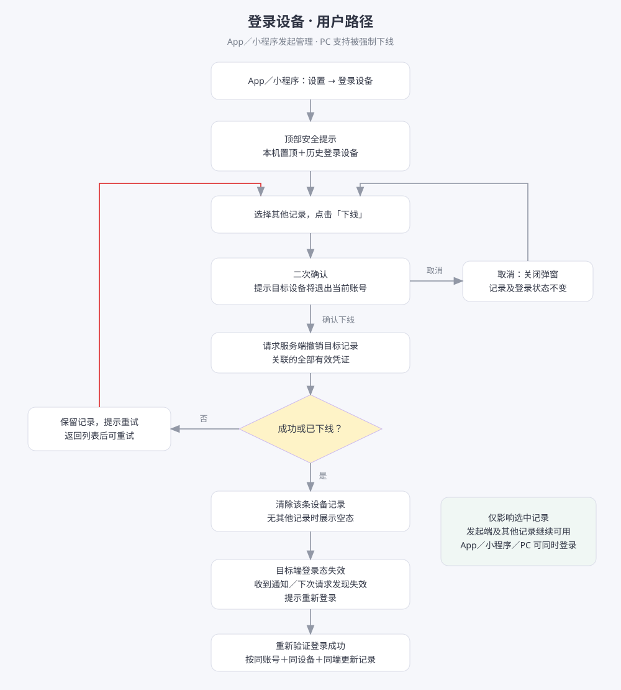
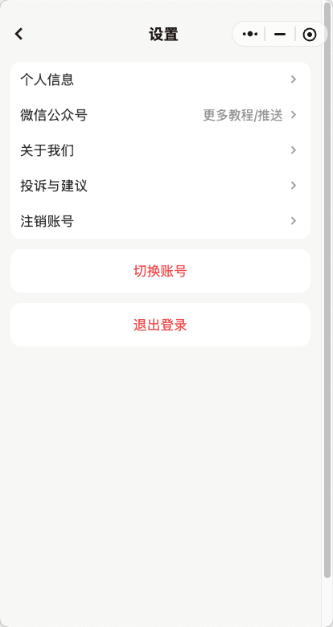
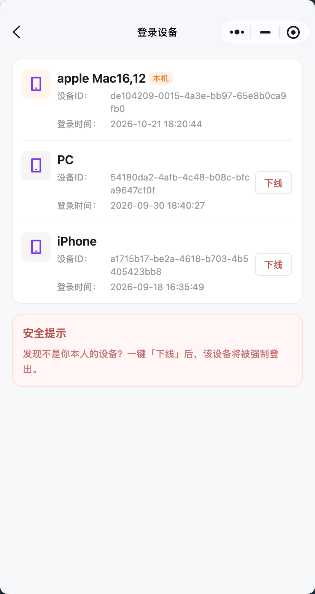

# 新增登录设备

## 1. 需求概述与范围

在设置列表的“切换账号”上方新增“登录设备”入口，查看当前账号的当前设备及历史登录设备，并支持强制下线其他设备。参考企业号登录设备页面。

- 业务线：右豹主业务（youbao）。
- 正式需求名：新增登录设备；产品分配编号：FR-002；本人身份：yu；上传分支：product-yu。
- 用户主要在 App、小程序使用设备列表；PC 本期采集登录信息、供列表展示并支持被强制下线，不新增设备管理入口。
- 本草稿配有本地可交互 UX 原型：`demo/iteration/fr-002.html`，使用示例数据，不接真实登录与下线接口。
- 本次按用户授权准备上传至 product-yu，正式文档及 Demo 与本需求同目录关联。

## 2. 三端能力

| 端 | 登录信息记录 | 设备列表管理入口 | 下线其他记录 | 被其他端下线 |
| --- | --- | --- | --- | --- |
| App（iOS、安卓） | 支持 | 设置 → 登录设备 | 支持 | 支持 |
| 小程序 | 支持 | 设置 → 登录设备 | 支持 | 支持 |
| PC | 支持，供 App、小程序展示 | 本期不新增 | 本期不提供 | 支持 |

同一账号允许三端同时登录，登录另一端不自动踢下线已有端。

## 3. 页面与字段规则

### FR-1 设置入口

“登录设备”并入现有设置列表，位于“注销账号”下一行、“切换账号”上方，不单独成块，沿用普通入口及右箭头。点击进入“登录设备”页面。

### FR-2 列表展示

1. 页面顶部展示固定文案：**安全提示：发现非本人设备，可点击「下线」，该设备将被强制退出登录。**
2. 提示下方为“当前登录设备”，置顶展示当前使用的登录记录，标记“本机”，无下线按钮。
3. 下方分组名称保留“历史登录设备”，展示当前账号其他仍有效的登录记录；不是已下线记录的审计日志，也不代表这些设备此刻在线。
4. 下线成功的记录从列表清除；无其他记录时展示“暂无其他登录设备”。重新进入或刷新列表以服务端最新结果为准。
5. 历史登录设备按最近一次成功登录时间倒序排列，最近登录的在前。
6. 列表布局紧凑，设备 ID 完整换行展示，不遮挡下线按钮。

| 信息 | 展示规则 |
| --- | --- |
| 标题 | 应用名称＋登录端，例如“右豹 App · iOS”“右豹 App · 安卓”“右豹小程序 · 微信”“右豹网页版 · PC” |
| 设备型号 | 作为补充信息展示；获取不到时不展示，不编造 |
| 设备 ID | 展示对应记录的设备标识；生成方式待研发核对 |
| 登录时间 | 最近一次成功登录时间；重新登录更新，自动续期不更新 |
| 本机标识 | 仅标记当前使用的记录；同一物理设备的其他登录端仍属于其他记录 |

旧记录缺少应用信息时回退显示 iOS、安卓、小程序或 PC。应用标识、登录端、设备信息随登录会话记录，由后台统一映射应用名称。

应用名称为右豹；登录端为安卓、iOS、小程序及 PC 网页版。标题示例：右豹 App · 安卓、右豹 App · iOS、右豹小程序、右豹网页版 · PC。

## 4. token、设备记录与账号规则

### FR-3 长期登录与去重（已确认）

- 当前登录后 token 长期有效，正常情况下长期保留登录态；异常状态可能需要重新登录。
- 关闭应用、退出后台或长期未使用，不直接视为已下线。
- 主动退出登录或账号异常导致 token 失效后，清除对应记录，仅保留仍有效的登录记录。
- **同一账号、同一设备、同一端只展示一条记录；异常后重新登录更新原记录，不新增重复展示记录。**
- 同一物理设备上的 App、小程序等不同登录端分别记录，不仅凭设备 ID 合并。PC 同一电脑的不同浏览器分别展示、分别下线；去重键需区分浏览器。
- **下线时撤销该记录关联的全部有效 token 及续期凭证**，确保记录清除后旧凭证无法继续使用。
- 重新主动登录验证成功后，按上述去重规则更新或恢复有效记录。

### FR-4 切换账号

- 列表只展示当前账号的记录；切换到另一账号后清除前一账号的可操作列表，再加载新账号数据。
- 下线只作用于选中记录对应的账号及登录端，不影响其他记录或其他账号。
- 当前使用的记录不提供下线操作，通过“切换账号”或“退出登录”处理本端账号。
- 已被下线账号即使保留在快捷切换列表中，也必须重新验证登录，不能通过快捷切换或自动续期恢复已撤销的登录态。

## 5. 强制下线规则

### FR-5 发起端交互

1. App 或小程序中点击其他记录的“下线”。
2. 弹出“确认下线该设备？”；提示“下线后，该设备将被强制退出当前账号，需要重新登录才能使用。”提供“取消”“确认下线”。
3. 取消后关闭弹窗，不改变记录及登录状态。
4. 确认后提交下线请求。**服务端成功后才清除记录**；不保留“已下线”条目。
5. 操作失败保留记录，提示“下线失败，请重试”；若设备已经下线则清除该记录；全部其他记录清除后展示空态。

### FR-6 被下线端处理

App、小程序、PC 均遵守：对应记录关联的全部有效 token 及续期凭证失效；服务端立即拒绝后续业务请求及续期。目标端获知失效后清理该账号登录态、阻止继续操作，提示“当前登录已被下线，请重新登录”，进入登录流程。

- 强制下线不需要目标端同意；二次确认由发起端用户完成。
- 即时跳转依赖通知机制；未收到通知或处于离线状态时，最迟在下一次请求收到失效结果后执行退出流程。
- 不影响发起端及其他未选中的记录；不承诺撤销下线前已成功提交的业务操作。

## 6. 用户路径图

以下为 App／小程序管理路径，PC 仅作为被管理端参与。图中“请求成功”表示服务端已撤销目标记录关联凭证。

## 7. 验收要点

- 设置列表入口位置正确，可进入设备列表并返回设置。
- 顶部安全提示、本机标识、历史分组及四类登录端展示正确。
- 同账号、同设备、同端只展示一条记录，异常重新登录更新原记录；不同端分别展示。
- 取消下线不改变状态，失败保留记录，成功移除记录；最后一条移除后显示空态。
- 同账号三端登录，App 或小程序下线 PC 后，PC 新业务及续期请求被拒绝；发起端和另一未选中端继续可用。
- 切换账号后不能查看或操作前一账号记录；已撤销凭证不能通过切换账号或续期恢复。
- 同一条展示记录关联的全部有效 token 均被撤销，不误伤其他账号。

## 8. 研发核对与同步信息

- 已确认：右豹主业务、正式需求名“新增登录设备”、FR-002、yu / product-yu。
- 研发核对：稳定设备标识与浏览器区分方式；现有登录信息字段及旧记录兼容；展示记录与全部 token 的关联和撤销；异常失效记录清理；多账号缓存不会恢复已撤销凭证。
- 产品规则按本文执行，研发核对不代表规则未定，也不表示现有系统已实现。
- “主动推广登录”按上下文整理为“主动退出登录”。
- 提交仅含本需求文档、Demo 及总览登记；发布 main 由维护人完成。

## 9. 参考附件

### 当前设置页

### 企业号登录设备页

