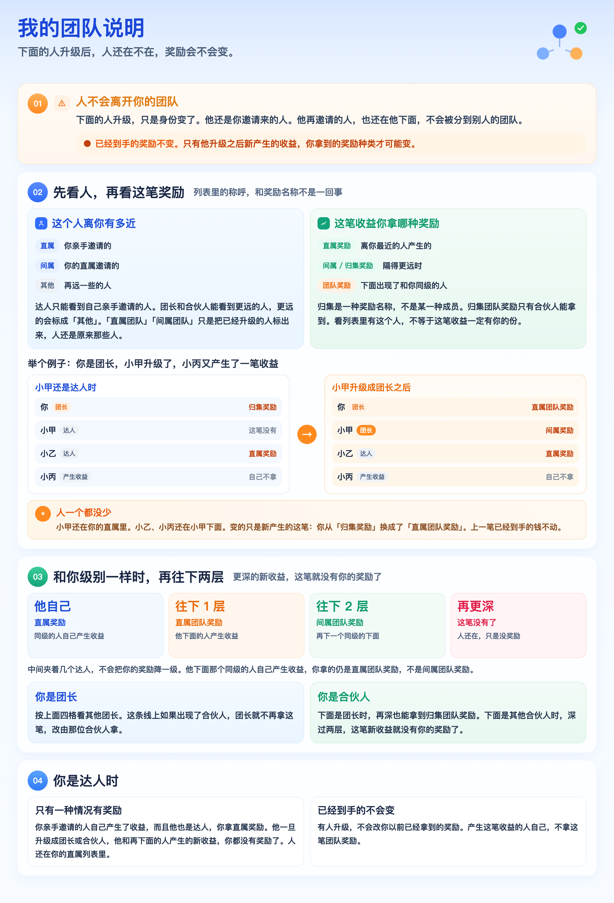

# 团队关系说明

| 项 | 内容 |
|---|---|
| 读者 | 业务、运营、产品 |
| 口径 | 当前代码：邀请树 `yx_user_team`，分红计算 `AgentCommissionCalculator` |
| 等级 | V1 达人（OPC创作经营体）、V2 团长（OPC团队主理人）、V3 合伙人（OPC生态合伙人） |
| 日期 | 2026-10-19 |

给业务、运营、产品直接看的图：

## 一、先看结论

1. **人不会被带走。** 升级只改这个人的等级 `yx_user.agent_level`，不改他的上级，也不改他下面的人挂在谁下面。直属升到和我同级之后，他还是我的直属；他的下级仍挂在他名下，也仍在我的团队树里。
2. **新单的分红档会变。** 已经结算进明细的历史分红不重算。升级之后才结算的单，按结算当时链上每个人的等级重算关系、重取比例。
3. **同级只往下认两档团队钱。** 直属团队、间属团队。再深的同级单，上面这个同级的比例是 0，这张新单他不再分红。人还在，只是这张单没他的份。
4. **成员关系和分红关系不是同一套词。** 成员列表第五档叫「其他」，没有「归集」。归集是分红金额的分桶。

## 二、两套关系

邀请关系存在 `yx_user_team`：`parent_user_id` 是直接上级，`path` 是从顶到这个人的整条路径。注册、补绑、静默换绑才会改这条树。升级、降级都不改。

| | 成员关系 | 分红关系 |
|---|---|---|
| 回答的问题 | 这个人在我下面第几层、是不是团长 | 他出的这张单，我按哪一档比例拿钱 |
| 看什么 | 上级是谁、他的等级 | 从我到出单人沿途每个人的等级 |
| 页面用词 | 直属、间属、直属团队、间属团队、其他 | 直属奖励、间属奖励、归集奖励、直属团队奖励、间属团队奖励、归集团队奖励 |
| 会不会因升级改变 | 直属还是直属；「直属团队」筛选会把他算进去，因为他升成了 V2/V3 | 会。同一条树，升级前后分到的档不同 |

## 三、成员关系

成员列表的 `relation`：

| 值 | 名称 | 条件 |
|---|---|---|
| 1 | 直属 | 直接上级是我 |
| 2 | 间属 | 直接上级的上级是我（我的二级） |
| 3 | 直属团队 | 直属，并且等级是 V2 或 V3 |
| 4 | 间属团队 | 间属，并且等级是 V2 或 V3 |
| 5 | 其他 | 三级及更远。成员列表里不叫归集 |

直属团队、间属团队是筛人，不是另一棵树。筛出来的人，不筛选时仍分别属于直属、间属。

谁能看见多深：

- V1 的成员列表只列出直属。
- V2、V3 按 `path` 列出全部下级，三级及更远显示为「其他」。

所以「其他」里的人，升级前就在这棵树里，升级后也还在。没有因为某人升到同级而被划到别的团长名下。

## 四、升级之后，团队还在不在

升级写入等级日志，并更新 `yx_user.agent_level`。不更新 `parent_user_id`，不重写下级的 `path`。

下面用「我 → 甲 → 乙 → 丙」表示邀请链，最右边是出单人。金额比例以后台 `yx_agent_ratio` 当时配置为准，这里只写落到哪一档。

### 1. 我是 V2，直属甲从 V1 升到 V2

升级前，甲、乙都是 V1，丙出单：

- 我到丙隔了两个人，按 V1 链算，我拿**归集奖励**。
- 甲不是「下一跳就是出单人」，作为 V1 拿不到这张单。
- 乙的下一跳就是丙，且丙是 V1，乙拿**直属奖励**。

升级后，甲变成 V2，乙、丙仍是 V1，丙再出单：

- 我拿**直属团队奖励**，来源记在甲。人还是原来那些人。
- 甲按 V2 拿乙、丙这条线的**间属奖励**（中间只有 V1）。
- 乙仍拿直属。

再往下出现同级时，我还能拿到哪一层。数「中间有几个 V2」时，不含我，也不含出单人本人：

| 链（我是 V2） | 出单人之前的 V2 个数 | 我这张单 |
|---|---|---|
| 我 → 甲(V2) 出单 | 0 | 直属奖励（明细文案是「直属（本人）」） |
| 我 → 甲(V2) → 只有 V1 → 出单 | 1（只有甲） | 直属团队奖励 |
| 我 → 甲(V2) → 丁(V2) 出单 | 1（只有甲，丁是出单人不计） | 直属团队奖励，不是间属团队 |
| 我 → 甲(V2) → 丁(V2) → 丙出单 | 2（甲和丁） | 间属团队奖励 |
| 我 → 甲(V2) → 丁(V2) → 戊(V2) → 丙出单 | 3 | 比例 0，我不分红 |
| 从我到出单人（含出单人）出现 V3 | — | 比例 0。这条链上的 V2 都不分红，改由那个 V3 按 V3 规则拿 |

最后两行就是业务上说的「被带走」：**人没走，这张新单的同级分红在我这里停了。** 停掉的部分由更近的那个同级或那个 V3 按他们自己的位置重算，不是把我账户里已有的钱划走。

### 2. 我是 V3，直属甲从 V2 升到 V3

升级前，甲是 V2，他下面可以有一长串 V2。V2 人数从我的下一级数到出单人之前：

| 这段里的 V2 人数 | 我这张单 |
|---|---|
| 0（甲自己就是出单人） | 直属奖励 |
| 1 | 直属团队奖励 |
| 2 | 间属团队奖励 |
| 3 个及以上 | **归集团队奖励**（这一档仍有比例） |

升成 V3 之后，改数出单人之前的 V3（不含我，也不含出单人本人），不再按上面那串 V2 给归集团队：

| 出单人之前的 V3 人数 | 例子 | 我这张单 |
|---|---|---|
| 甲自己就是出单人 | 我 → 甲(V3) 出单 | 直属奖励 |
| 1 | 我 → 甲(V3) → 丙出单；或 我 → 甲(V3) → 丁(V3) 出单（丁不计） | 直属团队奖励 |
| 2 | 我 → 甲(V3) → 丁(V3) → 丙出单 | 间属团队奖励 |
| 3 个及以上 | 我 → 甲(V3) → 丁(V3) → 戊(V3) → 丙出单 | 比例 0，我不分红 |

甲升成 V3 之后，他下面那些仍是 V2 的人，不再单独把我的「归集团队」顶出来，而是包在甲这个 V3 团队里，按上面的 V3 档计算。

### 3. 我是 V1，直属升到 V2 或 V3

V1 只有一种有比例的情况：下一跳就是出单人，并且出单人也是 V1。除此以外比例都是 0。

直属一旦升到 V2 或 V3，他本人再出单，以及他下面的人出单，我都不再有分红。他仍出现在我的直属列表里。

### 4. 升级不改历史

分红结算时，链上等级读的是当时的 `yx_user.agent_level`。升级前已经写入分红明细的单保持原档、原金额。升级后新结算的单用新等级。

## 五、分红怎么拿

### 1. 一笔单怎么变成各级的钱

订单审核通过后进入分红主单。结算时从出单人沿 `parent_user_id` 向上走出邀请链（最多 30 层），读链上每个人当时的 V 级，再按下表决定每个上级的关系档和比例。

计算公式：

> 这一级金额 = 分红主单 `total_profit` × 该档比例 ÷ 100

`total_profit` 是这张单用来分红的收益，不是订单原价流水。结果截断到小数 2 位；不足 0.01 元记 0。出单人自己不出现在这条团队分红里。

比例行按「平台 + 项目分润档 + 收钱人等级」取 `yx_agent_ratio`。具体用哪一列，由「来源人等级 + 关系档」决定，见文末对照表。后台改比例后，只影响之后结算的单。

链上任意一人在代理表 `yx_d1g_partner` 里，整单不做团队分红。

出单人已加入导师团时，先按上面算出毛金额，再按该导师团比例折成实发。实发在团队首页记入「服务带动奖励」，不计入下面六档。邀请树不变。服务带动的拆账见 `doc/服务带动与团队分红说明.md`。

### 2. 首页六档

| 首页名称 | 明细里的关系 | 谁的页面显示金额 |
|---|---|---|
| 直属奖励 | 直属、直属（本人） | V1 起 |
| 间属奖励 | 间属 | V2 起 |
| 归集奖励 | 归集 | V2 起 |
| 直属团队奖励 | 直属（团队流水） | V2 起 |
| 间属团队奖励 | 间属团队流水 | V2 起 |
| 归集团队奖励 | 归集（团队流水） | 仅 V3 |

未解锁的档，首页金额显示 0，并提示 V2 或 V3 可解锁。V1 除直属外，计算时比例本来就是 0。V2 不会产生归集团队明细。

### 3. 什么时候落在哪一档

先看收钱人自己的等级，再看他的下一级到出单人。

**V1 收钱**

- 下一级就是出单人，且出单人是 V1：直属奖励。
- 其他情况：不发钱。

**V2 收钱**

- 从我到出单人（含出单人）出现 V3：不发钱。
- 下一级就是 V2：按同级算。出单人之前的 V2 个数（不含出单人）为 0 时是直属奖励，为 1 是直属团队，为 2 是间属团队，为 3 及以上不发钱。个数为 0 只发生在这个 V2 自己出单。
- 下一级是 V1，出单人之前先碰到 V2：中间的 V1 不占层数，从那个 V2 起按上一行的个数算团队档。若唯一的 V2 就是出单人本人、他前面全是 V1，不进团队档，改走下面的跳数，用来源 V1 的间属或归集比例。
- 没有被认成同级团队时，按到出单人的跳数，用来源 V1 的比例：
  - 下一级就是出单人：直属奖励。
  - 隔 1 个人：间属奖励。
  - 隔 2 个人及以上：归集奖励。

**V3 收钱**

- 出单人是 V3，且出单人之前没有别的 V3：直属奖励。
- 出单人之前有 V3：1 个为直属团队，2 个为间属团队，3 个及以上不发钱。出单人本人不计入。来源按 V3。因此「我 → 甲(V3) → 丁(V3) 出单」只数甲，是直属团队。
- 下一级是 V2，且到出单人没有 V3：出单人之前的 V2 个数为 0 是直属奖励，1 是直属团队，2 是间属团队，3 个及以上是**归集团队奖励**（仍有比例）。来源按 V2。
- 下一级是 V1，到出单人之前全是 V1，且出单人是 V2：直属奖励，按 V2 的直属比例。中间的 V1 不算成间属。
- 下一级是 V1，出单人之前先碰到 V2：中间的 V1 不占层数。从那个 V2 数到出单人之前，1 个 V2 为直属团队，2 个为间属团队，3 个及以上为归集团队。
- 没有 V2、V3 可认时，按跳数用来源 V1 的比例：1 跳直属，2 跳间属，3 跳及以上归集。

中间的 V1 叫垫层：判同级团队时跳过，不因为多隔了几个 V1 就把直属团队降成间属。

### 4. 和成员列表的对应，不要混着对账

| 成员列表 | 分红上容易对上的情况 | 对不上的情况 |
|---|---|---|
| 直属 | 他本人是 V1 且他出单，我拿直属奖励 | 他已是 V2/V3 再出单，我拿的是「直属（本人）」，首页仍算在直属奖励，比例列不同 |
| 间属 | 中间只有 V1、我是 V2/V3 时，常是间属奖励 | 中间有同级时，会变成团队档 |
| 直属团队（人） | 只说明这个直属是 V2 或 V3 | 他下面的人出单，我可能拿直属团队奖励，也可能是间属团队或 0 |
| 间属团队（人） | 只说明这个二级是 V2 或 V3 | 同上，不能把「列表里的人」直接加总成「团队奖励」 |
| 其他 | 三级及更远的人 | 其中一部分单我拿归集或归集团队，超过同级窗口的单我拿 0 |

## 六、比例列对照

收钱人用自己等级那一行配置。列名的前半是来源人等级（one=V1，two=V2，three=V3），后半是关系。

| 关系 | 来源 V1 | 来源 V2 | 来源 V3 |
|---|---|---|---|
| 直属 / 直属（本人） | `one_one_ratio` | `two_one_ratio` | `three_one_ratio` |
| 间属 | `one_two_ratio` | `two_two_ratio` | 无此列，不发 |
| 直属团队 | `one_ones_ratio`（计算不会取到） | `two_ones_ratio` | `three_ones_ratio` |
| 间属团队 | `one_twos_ratio`（计算不会取到） | `two_twos_ratio` | `three_twos_ratio` |
| 归集 / 归集团队 | `one_three_ratio` | `two_three_ratio` | 同级 V3 过深时比例被置 0，不读列 |

页面权益文案（身份说明）与上表同一批字段，例如 V3 看 V2 来源时：`two_one_ratio` 为直属 V2 自推，`two_ones_ratio` 为直属 V2 团队，`two_three_ratio` 为 V2 团队归集。

## 七、代码位置

| 内容 | 位置 |
|---|---|
| 成员五档 | `TeamMemberRelationService`、`TeamMemberListQueryService` |
| 分红关系与比例 | `AgentCommissionCalculator`、`AgentRatioFieldResolver` |
| 邀请链 | `AgentDivvyChainResolver`（只沿 `parent_user_id` 向上） |
| 升级只改等级 | `TeamAgentLevelUpgradeService` |
| 首页六档解锁 | `TeamHomeDivvyBreakdownService` |
