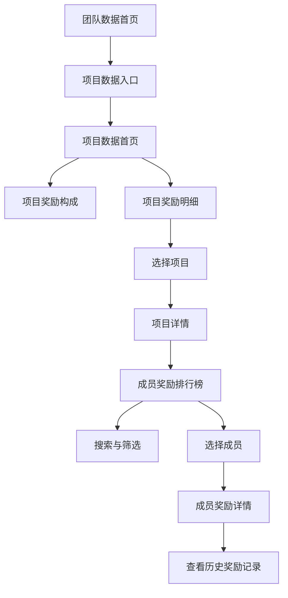

# 团队项目数据分析需求规则 PRD V1.0

## 一、需求概述

### 1.1 需求背景

当前团队数据页面主要展示团队奖励和成员数据，缺少项目维度的奖励分析能力。

用户无法直观了解：
- 团队奖励主要来源于哪些项目。
- 不同项目分别产生了多少奖励。
- 各项目的奖励占比及变化情况。
- 每个项目有多少成员产生过奖励。
- 哪些成员为指定项目带来了更多团队奖励。

因此，在现有团队数据体系中新增「项目数据」功能，实现项目奖励分析及成员奖励排行。

### 1.2 需求目标

1. 支持按照项目维度分析团队奖励。
2. 支持展示各项目奖励金额及奖励构成。
3. 支持查看每个项目的累计、今日、昨日奖励。
4. 支持按奖励金额对项目进行排序。
5. 支持进入指定项目查看成员奖励排行榜。
6. 支持查看单个成员的项目奖励详情。
7. 确保项目奖励、成员奖励与团队奖励统计口径一致。

### 1.3 功能范围

| 一级模块 | 二级模块 | 功能 |
|---|---|---|
| 团队数据 | 团队奖励 | 保留原有功能 |
| 团队数据 | 成员数据 | 保留原有功能 |
| 团队数据 | 项目数据入口 | 新增独立入口 |
| 项目数据 | 奖励构成 | 项目奖励占比分析 |
| 项目数据 | 项目奖励明细 | 项目奖励统计及排序 |
| 项目数据 | 项目详情 | 指定项目奖励分析 |
| 项目详情 | 成员奖励排行榜 | 成员奖励排序与筛选 |
| 成员排行榜 | 成员奖励详情 | 单成员奖励统计及历史记录 |

---

## 二、核心业务流程

### 2.1 页面跳转规则

| 当前页面 | 操作 | 结果 |
|---|---|---|
| 团队数据首页 | 点击项目数据入口 | 进入项目数据首页 |
| 项目数据首页 | 点击指定项目 | 进入该项目详情 |
| 项目详情 | 查看成员排行 | 展示当前项目成员排行榜 |
| 成员排行榜 | 点击成员 | 打开成员奖励详情抽屉 |
| 成员详情 | 关闭抽屉 | 返回当前成员排行榜 |
| 项目详情 | 点击返回 | 返回项目数据首页 |
| 项目数据首页 | 点击返回 | 返回团队数据首页 |

页面返回时，优先保留上一层的筛选、排序和滚动位置。

---

## 三、团队数据首页

### 3.1 页面布局

保持原有团队数据页面结构。

在「成员数据」模块下方增加「项目数据」独立入口卡片。

不改变原有团队奖励及成员数据的统计规则。

### 3.2 项目数据入口字段规则

| 位置 | 功能 | 字段名 | 数据源 | 是否可编辑 | 具体规则 |
|---|---|---|---|---|---|
| 成员数据下方 | 模块入口 | 项目数据 | 系统配置 | 否 | 固定显示「项目数据」 |
| 入口左侧 | 功能图标 | 项目图标 | 前端资源 | 否 | 使用图表类图标，沿用品牌橙红色 |
| 入口中部 | 功能说明 | 查看项目奖励构成与排行 | 固定文案 | 否 | 单行或两行展示 |
| 入口右侧 | 项目数量 | 奖励项目数 | 奖励统计服务 | 否 | 统计当前团队累计产生过有效奖励的去重项目数 |
| 入口右侧 | 跳转标识 | 右箭头 | 前端资源 | 否 | 表示可进入详情 |

### 3.3 入口交互规则

1. 整张入口卡片均可点击。
2. 点击后进入项目数据首页。
3. 入口仅显示项目数，不显示成员数、累计奖励或今日奖励。
4. 项目数量为 0 时，显示「0 个」。
5. 无项目数据时仍允许进入，展示空状态。
6. 入口数量应与项目数据页累计口径下的有效奖励项目数量一致。
7. 不影响现有成员数据模块的展示和交互。

---

## 四、项目数据首页

### 4.1 页面结构

项目数据首页由以下部分组成：

1. 项目奖励概览。
2. 项目奖励构成环形图。
3. 项目奖励明细列表。
4. 项目详情入口。

### 4.2 项目奖励概览

| 位置 | 字段名 | 数据源 | 是否可编辑 | 具体规则 |
|---|---|---|---|---|
| 页面顶部 | 累计奖励 | 团队奖励统计服务 | 否 | 当前团队全部项目累计有效奖励 |
| 页面顶部 | 今日奖励 | 团队奖励统计服务 | 否 | 当前自然日的项目奖励 |
| 页面顶部 | 昨日奖励 | 团队奖励统计服务 | 否 | 上一自然日的项目奖励 |
| 页面顶部 | 奖励项目数 | 项目奖励汇总 | 否 | 累计产生有效奖励的去重项目数 |

### 4.3 统计原则

- 金额统一保留两位小数。
- 金额单位为元。
- 今日、昨日采用统一业务时区。
- 累计奖励与现有团队奖励使用相同的历史统计范围。
- 项目奖励不能直接通过成员个人收入累加计算。
- 不允许同一笔团队奖励在多个项目重复统计。

---

## 五、项目奖励构成

### 5.1 展示方式

采用环形图展示不同项目的奖励占比。

环形图中间展示当前筛选时间范围内的奖励总额。

图表下方或右侧展示项目名称、颜色标识及奖励占比。

### 5.2 日期筛选

日期筛选组件放置于「项目奖励构成」标题右侧。

| 字段 | 可选值 | 默认值 | 交互规则 |
|---|---|---|---|
| 时间范围 | 累计、今日、昨日 | 累计 | 点击后切换对应奖励构成 |
| 奖励总额 | 当前时间范围奖励 | 自动计算 | 切换后同步刷新 |
| 项目占比 | 当前项目奖励 / 当前范围全部项目奖励 | 自动计算 | 保留适当的小数精度 |

### 5.3 饼图项目数量上限

为避免项目过多导致图表拥挤，设置项目展示上限。

**V1 默认展示前 4 个项目。**

| 场景 | 展示规则 |
|---|---|
| 项目数 ≤ 4 | 全部独立展示 |
| 项目数 > 4 | 展示前 4 个项目，其余合并为「更多项目」 |
| 项目奖励为 0 | 不参与当前时间范围的饼图占比 |
| 当前范围全部奖励为 0 | 展示无奖励数据状态 |

### 5.4 更多项目规则

1. 根据当前时间范围内的奖励金额降序排列。
2. 奖励排名前 4 的项目独立展示。
3. 第 5 名及之后的项目合并为「更多项目」。
4. 「更多项目」金额为其包含项目奖励之和。
5. 「更多项目」占比按合并金额计算。
6. 切换时间范围时重新计算项目排名及分组。
7. 「更多项目」仅影响图表展示，不影响下方项目明细列表。
8. V1 不要求点击「更多项目」展开二级饼图。

### 5.5 占比计算

计算公式：

`项目奖励占比 = 项目当前范围奖励 ÷ 当前范围全部项目奖励 × 100%`

更多项目占比：

`更多项目占比 = 其他项目奖励合计 ÷ 当前范围全部项目奖励 × 100%`

占比建议保留一位小数。

图表计算使用未四舍五入的原始数值，避免展示精度影响统计结果。

---

## 六、项目奖励明细

### 6.1 列表字段

| 位置 | 字段名 | 数据源 | 是否可编辑 | 具体规则 |
|---|---|---|---|---|
| 项目卡片 | 项目名称 | 项目基础信息 | 否 | 显示对应项目名称 |
| 项目卡片 | 项目图标 | 项目基础信息 | 否 | 优先使用项目官方图标 |
| 项目卡片 | 累计奖励 | 项目奖励汇总 | 否 | 展示该项目累计有效团队奖励 |
| 项目卡片 | 今日奖励 | 项目奖励汇总 | 否 | 展示今日有效团队奖励 |
| 项目卡片 | 昨日奖励 | 项目奖励汇总 | 否 | 展示昨日有效团队奖励 |
| 项目卡片 | 成员数 | 成员奖励统计 | 否 | 累计在该项目产生过有效奖励的去重成员数 |
| 项目卡片 | 详情入口 | 前端交互 | 否 | 点击进入项目详情 |

### 6.2 排序规则

项目明细增加排序组件。

| 排序选项 | 排序规则 |
|---|---|
| 累计高到低 | 按项目累计奖励降序 |
| 今日高到低 | 按项目今日奖励降序 |
| 昨日高到低 | 按项目昨日奖励降序 |

默认排序：**累计高到低**。

补充规则：

1. 切换排序后立即更新列表。
2. 排序只改变展示顺序，不改变奖励统计。
3. 金额相同时，按累计奖励降序进行二次排序。
4. 若仍相同，则按项目 ID 稳定排序。
5. 所有项目均参与排序，不受饼图展示数量限制。

### 6.3 项目列表规则

1. 展示当前团队有权查看且累计产生过有效奖励的全部项目。
2. 今日奖励为 0 的项目仍需展示。
3. 昨日奖励为 0 的项目仍需展示。
4. 项目卡片整体可点击。
5. 项目数据与成员排行榜使用相同的项目 ID。
6. 项目停用不应自动删除历史奖励记录。

---

## 七、项目详情与成员奖励排行榜

### 7.1 页面结构

进入项目详情后展示：

1. 项目名称及基础信息。
2. 项目累计奖励。
3. 今日奖励。
4. 昨日奖励。
5. 累计奖励成员数。
6. 成员奖励排行榜。
7. 成员搜索、筛选及排序。

### 7.2 成员排行榜统计口径

**采用方案 A：成员实际为当前团队带来的奖励。**

定义：

成员在指定项目产生的业务行为，最终为当前团队账号带来的有效团队奖励金额。

不使用成员个人项目收益作为排行榜依据。

计算公式：

`成员项目奖励 = 指定项目下归属于该成员、当前团队账号的有效奖励流水金额合计`

### 7.3 排行榜字段

| 位置 | 字段名 | 数据源 | 是否可编辑 | 具体规则 |
|---|---|---|---|---|
| 排行榜 | 排名 | 统计计算 | 否 | 按当前排序条件生成 |
| 排行榜 | 成员头像 | 用户信息 | 否 | 无头像使用默认头像 |
| 排行榜 | 成员昵称 | 用户信息 | 否 | 展示当前昵称 |
| 排行榜 | 用户 ID | 用户信息 | 否 | 展示唯一用户标识 |
| 排行榜 | 奖励金额 | 团队奖励流水 | 否 | 当前项目、当前时间范围内的有效奖励 |
| 排行榜 | 奖励占比 | 统计计算 | 否 | 成员奖励占当前项目同时间范围奖励的比例 |
| 排行榜 | 奖励归属 | 奖励流水 | 否 | 直属、间属、服务带动等归属类型 |
| 排行榜 | 详情入口 | 前端交互 | 否 | 点击成员打开详情抽屉 |

### 7.4 时间筛选

| 筛选项 | 规则 |
|---|---|
| 累计 | 展示项目累计奖励排行 |
| 今日 | 展示当前自然日奖励排行 |
| 昨日 | 展示上一自然日奖励排行 |
| 自定义日期 | 支持选择开始及结束日期 |

默认选择累计。

自定义日期包含开始日期和结束日期当日。

### 7.5 成员搜索

支持：

- 成员昵称模糊搜索。
- 用户 ID 精确搜索。
- 搜索结果与当前时间筛选、归属筛选共同生效。

搜索无结果时展示空状态。

### 7.6 成员排序

| 排序项 | 规则 |
|---|---|
| 奖励高到低 | 当前筛选时间范围奖励降序 |
| 奖励低到高 | 当前筛选时间范围奖励升序 |
| 昵称排序 | 按昵称排序 |

默认奖励高到低。

### 7.7 排名规则

1. 排名基于当前项目、时间范围及归属筛选结果计算。
2. 默认仅展示当前筛选范围内有有效正向奖励的成员。
3. 金额相同的成员使用相同名次。
4. 后续名次按竞赛排名规则计算，例如 1、2、2、4。
5. 搜索成员时保留该成员在当前筛选榜单中的原始名次。
6. 翻页或加载更多不重新计算排名。

---

## 八、成员奖励详情

### 8.1 展示方式

采用移动端底部抽屉。

点击排行榜中的成员卡片后打开。

### 8.2 字段规则

| 字段名 | 数据源 | 是否可编辑 | 具体规则 |
|---|---|---|---|
| 成员头像 | 用户信息 | 否 | 显示头像 |
| 成员昵称 | 用户信息 | 否 | 显示当前昵称 |
| 用户 ID | 用户信息 | 否 | 显示唯一 ID |
| 项目名称 | 项目基础信息 | 否 | 显示当前项目 |
| 累计奖励 | 奖励流水 | 否 | 该成员为当前团队带来的累计奖励 |
| 今日奖励 | 奖励流水 | 否 | 当前自然日奖励 |
| 昨日奖励 | 奖励流水 | 否 | 上一自然日奖励 |
| 当前范围奖励 | 奖励流水 | 否 | 当前排行榜时间范围内的奖励 |
| 奖励归属 | 奖励流水 | 否 | 按实际奖励记录展示归属分类 |
| 历史奖励记录 | 奖励流水 | 否 | 按时间倒序展示 |

### 8.3 抽屉交互

1. 点击成员打开详情。
2. 点击关闭按钮或遮罩关闭。
3. 关闭后保留排行榜筛选条件。
4. 详情数据仅统计当前项目。
5. 不混入其他项目奖励。
6. 无历史记录时显示空状态。
7. 历史记录较多时支持分页加载。

---

## 九、奖励统计及归属规则

### 9.1 核心统计原则

项目奖励必须与现有团队奖励口径一致。

同一笔奖励流水应具有：

- 奖励流水 ID。
- 项目 ID。
- 贡献成员 ID。
- 奖励接收账号 ID。
- 奖励金额。
- 奖励归属类型。
- 业务归属时间。
- 结算时间。
- 奖励状态。

### 9.2 奖励归属分类

| 类型 | 统计规则 |
|---|---|
| 直属奖励 | 按现有直属奖励规则统计 |
| 间属奖励 | 按现有间属奖励规则统计 |
| 服务带动奖励 | 按现有导师团服务带动奖励规则统计 |

### 9.3 服务带动奖励规则

1. 成员加入导师团后，原邀请关系不变。
2. 加入导师团后产生的适用奖励计入服务带动奖励。
3. 不再重复计入直属、间属等分项。
4. 团队总奖励包含服务带动奖励。
5. 历史已产生奖励保留原归属。
6. 不允许因为成员当前身份变化而重新覆盖历史奖励分类。
7. 同一成员可以在历史上存在多种奖励归属类型。

### 9.4 数据去重

同一笔奖励流水不得在同一个团队账号的项目统计中重复计算。

统计应以唯一奖励流水及其有效归属记录为依据。

### 9.5 奖励冲正

发生退款、撤销或奖励调整时：

1. 保留原始奖励流水。
2. 新增调整或冲正记录。
3. 按业务规则更新有效奖励金额。
4. 项目汇总及成员汇总同步更新。
5. 保留调整前后的记录以支持对账。
6. 不直接删除原始历史数据。

### 9.6 数据一致性

同一统计范围内：

`项目奖励总额 = 全部项目有效奖励合计`

`项目奖励总额 = 该项目成员有效奖励合计 + 未分配或待归因调整金额`

正常情况下，未分配或待归因金额应为 0。

如存在异常，需保留可追溯的调整记录，不得将差额直接分配给任意成员。

---

## 十、数据权限

### 10.1 权限原则

按照现有团队数据权限体系控制。

### 10.2 权限规则

1. 用户只能查看当前账号有权访问的团队奖励数据。
2. 项目列表只展示当前权限范围内的项目。
3. 成员排行榜只展示当前权限范围内的成员奖励。
4. 成员详情不能越权查看其他团队的数据。
5. 前端隐藏不等于权限控制，接口必须进行服务端权限校验。
6. 项目数据、成员排行、成员详情必须使用一致的权限范围。

---

## 十一、页面状态

| 场景 | 展示规则 |
|---|---|
| 首次加载 | 展示骨架屏 |
| 加载失败 | 展示失败提示及重试入口 |
| 项目数为 0 | 显示项目空状态 |
| 今日无奖励 | 显示 0.00 |
| 饼图无有效数据 | 展示暂无奖励数据 |
| 项目无成员排行 | 展示暂无成员奖励记录 |
| 成员搜索无结果 | 展示无匹配成员 |
| 加载更多失败 | 保留已加载数据并支持重试 |
| 项目已停用 | 保留有权限查看的历史奖励数据 |

---

## 十二、视觉与交互规范

### 12.1 品牌色系

| 用途 | 色值 |
|---|---|
| 品牌主色 | `#FF603B` |
| 辅助橙色 | `#FF976F` |
| 浅橙色 | `#FFBD92` |
| 暖色背景 | `#FFF3EE` |
| 页面辅助背景 | `#F5F6F8` |

### 12.2 设计要求

1. 延续现有团队数据页面视觉体系。
2. 项目数据入口采用独立卡片。
3. 项目入口不重复展示奖励金额。
4. 重点奖励金额使用品牌主色。
5. 普通内容卡片以白色为主。
6. 环形图使用同色系多层次配色，并保证相邻区块可区分。
7. 筛选器、排序器保持紧凑。
8. 详情字段较多时优先采用抽屉。
9. 适配主流移动端屏幕。
10. 避免使用过多高饱和背景影响信息阅读。

---

## 十三、验收标准

| 编号 | 验收项 | 预期结果 |
|---|---|---|
| AC01 | 团队数据首页 | 原有团队奖励、成员数据正常显示 |
| AC02 | 项目入口 | 成员数据下方出现独立项目数据卡片 |
| AC03 | 项目数 | 入口显示正确的奖励项目数量 |
| AC04 | 入口跳转 | 点击卡片进入项目数据首页 |
| AC05 | 饼图筛选 | 累计、今日、昨日切换正确 |
| AC06 | 饼图上限 | 超过 4 个项目自动合并更多项目 |
| AC07 | 项目明细 | 全部有效项目均可查看 |
| AC08 | 项目排序 | 三种降序排序正确 |
| AC09 | 项目下钻 | 任意项目均可进入详情 |
| AC10 | 成员排行 | 按成员实际带来的团队奖励计算 |
| AC11 | 成员筛选 | 日期、昵称、用户 ID、归属筛选正常 |
| AC12 | 成员排序 | 奖励排序正确 |
| AC13 | 成员详情 | 点击成员正确打开详情抽屉 |
| AC14 | 奖励归属 | 服务带动奖励不重复统计 |
| AC15 | 历史数据 | 身份变化不覆盖历史奖励归属 |
| AC16 | 奖励冲正 | 项目及成员金额正确同步 |
| AC17 | 数据权限 | 不可访问无权限团队或成员数据 |
| AC18 | 页面返回 | 返回后保留筛选及排序状态 |
| AC19 | 空状态 | 无数据、无结果、失败状态正常 |
| AC20 | 视觉一致性 | 全部页面使用品牌橙红色系 |

---

## 十四、待产品确认事项

以下问题不影响 Demo 演示，但正式开发前需要统一口径。

### P01：奖励日期归属

今日、昨日奖励按照哪种日期统计？

- 方案 A：奖励业务产生日期。
- 方案 B：奖励结算入账日期。

建议与现有团队奖励页面保持一致。

### P02：奖励成员数

当前建议采用累计产生过有效奖励的去重成员数。

需要确认：历史奖励全部冲正为 0 的成员，是否仍计入累计奖励成员数。

### P03：项目统计范围

当前建议项目入口只统计累计产生过有效奖励的项目。

需要确认：历史奖励全部冲正的项目，是否仍保留在项目数据列表中。

### P04：成员奖励明细深度

V1 建议展示成员奖励汇总和历史奖励记录。

是否需要进一步下钻到关联订单或业务来源明细，待后续确认。

### P05：奖励调整日期

跨日退款、冲正或补发奖励时，需要明确是否回写原业务日期或记录在调整发生日期。

此规则应与现有团队奖励统计系统保持一致。

---

## 十五、版本说明

| 项目 | 内容 |
|---|---|
| 版本 | V1.0 |
| 功能名称 | 团队项目数据分析 |
| 终端 | 移动端 |
| 页面风格 | 品牌橙红色系 |
| 统计方案 | 方案 A |
| 需求范围 | 项目入口、奖励构成、项目明细、成员排行、成员详情 |
| 状态 | 产品需求整理版，待统计口径最终确认 |
